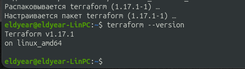
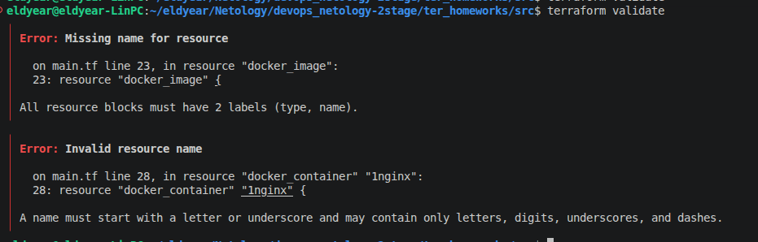
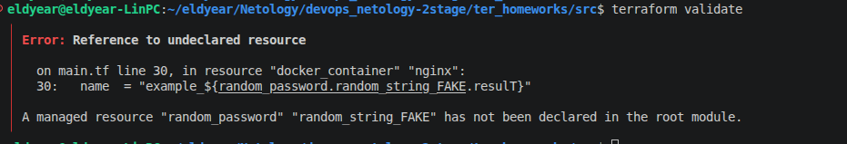
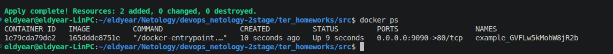
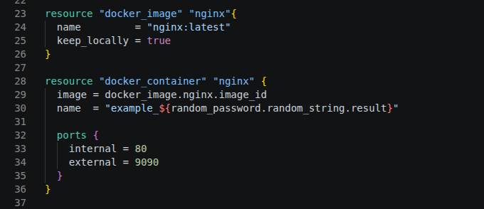
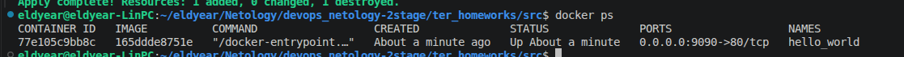
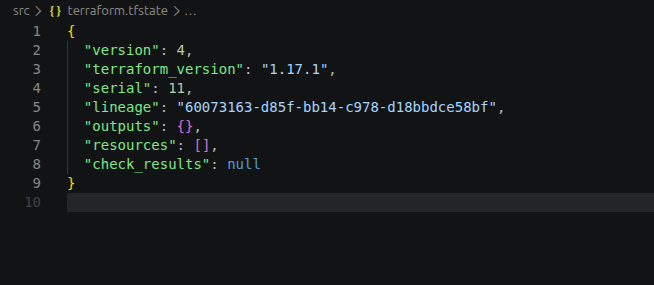

# Домашнее задание к занятию «Введение в Terraform» - Элдияр Акматов

В .gitignore разрешено хранение секретов в файле `personal.auto.tfvars` а также в любых файлах вида `*.auto.tfvars` или `*.tfvars`. Terraform подгружает переменные из файлов с расширением .auto.tfvars, а .gitignore защищает от попадания в публичный репозиторий.



"result": "GVFLw5kMohW8jR2b"


`name  = "example_${random_password.random_string_FAKE.resulT}"`
- Первая ошибка: не указан второй lable
- Вторая ошибка: имя должно начинаться с буквы или символа подчёркивания и может содержать только буквы, цифры, символы подчёркивания и дефисы
- Третья ошибка: "random_password" "random_string_FAKE" не был указан в корневом модуле (_FAKE лишьний)
- Четверная ошибка: в регистре буквы T в атрибуте .resulT




Вывод команды `docker ps`



Исправленный фрагмент кода



- Минусы: Ключ -auto-approve пропускает интерактивный этап подтверждения, это опасно тем что может привести к случайному или несанкционированному применению изменений в продакшене, например удалению или пересозданию критических ресурсов без предварительного осмотра плана.
- Плюсы: Он необходим для работы в неинтерактивных средах — CI/CD пайплайнах, или автоматических скриптах деплоя, отключает интерактивный запрос на подтверждение



Содержимое `terraform.tfstate` после `terraform destroy`



```hcl
resource "docker_image" "nginx"{
  name         = "nginx:latest"
  keep_locally = true
}
```
строка `keep_locally = true` не дает `destroy` удалить образ.

- `keep_locally` (Boolean) If true, then the Docker image won't be deleted on destroy operation. If this is false, it will delete the image from the docker local storage on destroy operation.
